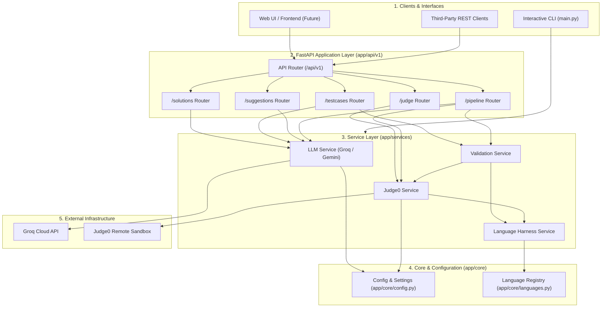

# AI Coding Platform

An AI-powered competitive programming practice and automated evaluation platform. The system leverages **Groq LLMs** for code generation, test-case synthesis, and mentoring guidance, combined with **Judge0** for secure, sandboxed multi-language code execution.

---

## 🚀 5-Layer System Architecture

The backend is organized into five strict architectural layers:



### Architectural Principles:
1. **Direct Service Access for CLI:** The interactive terminal CLI calls the service layer directly without HTTP overhead.
2. **Stateless API Layer:** API routers contain zero business logic and delegate completely to injected services via FastAPI `Depends`.
3. **Framework Independence:** Services do not depend on FastAPI `Request` objects or HTTP semantics.
4. **Isolated Integrations:** Groq and Gemini clients reside strictly inside `LLMService`.
5. **Zero Local Host Execution:** All user code and reference solutions run sandboxed inside `JudgeService` on remote Judge0 containers.

---

## 📂 Project Structure

```text
AI coding/
├── .env.example                                      # Template for environment configuration
├── .gitignore                                        # Secret and environment exclusions
├── main.py                                           # Interactive CLI pipeline runner
├── gemini.py                                         # Model inspection & GenAI testing sandbox
├── requirements.txt                                  # Pinned dependencies
├── README.md                                         # Project documentation
│
├── app/                                              # Modular FastAPI Backend
│   ├── main.py                                       # FastAPI entry point & root router
│   ├── core/                                         # Configuration & constants
│   │   ├── config.py                                 # Strongly typed Pydantic Settings
│   │   └── languages.py                              # Centralized language registry & ID mapping
│   ├── schemas/                                      # Pydantic V2 Request & Response models
│   │   ├── common.py                                 # Health & error schemas
│   │   ├── solution.py                               # Solution generation schemas
│   │   ├── testcase.py                               # Test case synthesis & validation schemas
│   │   ├── judge.py                                  # Submission & evaluation schemas
│   │   ├── suggestion.py                             # Mentor feedback schemas
│   │   └── pipeline.py                               # End-to-end pipeline schemas
│   ├── services/                                     # Decoupled domain business logic
│   │   ├── harness_service.py                        # Multi-language code wrappers (Python, JS, C++, etc.)
│   │   ├── judge_service.py                          # Judge0 communication & execution
│   │   ├── llm_service.py                            # Groq & Gemini provider isolation
│   │   └── validation_service.py                     # Sandboxed reference verification
│   └── api/                                          # FastAPI Application Routers
│       ├── deps.py                                   # Dependency injection providers
│       └── v1/
│           ├── router.py                             # Aggregate API v1 router
│           └── endpoints/
│               ├── health.py                         # GET /health, GET /languages
│               ├── solutions.py                      # POST /api/v1/solutions/generate
│               ├── testcases.py                      # POST /api/v1/testcases/generate & /validate
│               ├── judge.py                          # POST /api/v1/judge/evaluate
│               ├── suggestions.py                    # POST /api/v1/suggestions/generate
│               └── pipeline.py                       # POST /api/v1/pipeline/run
│
├── funtions/                                         # Backwards-compatibility adapters (re-exports)
│   ├── extract_codes.py
│   ├── suggestion.py
│   ├── usercode_evaluation.py
│   ├── validate_testcases.py
│   └── complete_test_cases/
│
└── tests/                                            # 83 Automated Tests (100% Mocked Offline)
    ├── api/                                          # FastAPI TestClient endpoint integration tests
    ├── unit/                                         # Service & core configuration unit tests
    └── ...                                           # Regression & legacy test suites
```

---

## 🛠️ REST API Specification (`/api/v1`)

| Method | Endpoint | Description | Request Body |
| :--- | :--- | :--- | :--- |
| `GET` | `/health` | Application health status | — |
| `GET` | `/api/v1/languages` | Supported languages & Monaco IDs | — |
| `POST` | `/api/v1/solutions/generate` | Generate Brute Force & Optimal code | `{"problem": "string", "model": "string?"}` |
| `POST` | `/api/v1/testcases/generate` | Generate AI edge & boundary test cases | `{"problem": "string", "model": "string?"}` |
| `POST` | `/api/v1/testcases/validate` | Sandboxed verification on Judge0 | `{"brute_code": "str", "optimal_code": "str", "testcases": [...]}` |
| `POST` | `/api/v1/judge/evaluate` | Evaluate user code on Judge0 | `{"code": "str", "language": "str | int", "testcases": [...]}` |
| `POST` | `/api/v1/suggestions/generate`| Generate AI mentoring feedback | `{"problem": "str", "user_code": "str", "eval_result": {...}}` |
| `POST` | `/api/v1/pipeline/run` | Full 5-stage automated pipeline | `{"problem": "str", "user_code": "str", "language": "str"}` |

Interactive OpenAPI documentation is available at `/docs` (Swagger UI) and `/redoc`.

---

## ⚙️ Setup & Installation

### 1. Install Dependencies
```bash
pip install -r requirements.txt
```

### 2. Configure Environment Variables
Copy `.env.example` to `.env`:
```bash
cp .env.example .env
```
Ensure your credentials are set in `.env`:
```env
GROQ_API_KEY=your_groq_api_key_here
GROQ_MODEL=openai/gpt-oss-120b
JUDGE0_URL=https://ce.judge0.com/submissions?wait=true
```

---

## 🖥️ Running the Application

### Option A: Start the FastAPI Server
```bash
uvicorn app.main:app --host 0.0.0.0 --port 8000 --reload
```
Access the interactive documentation: `http://localhost:8000/docs`

### Option B: Interactive CLI Practice Runner
```bash
python main.py
```

---

## 🧪 Automated Testing

Run all 83 unit and API integration tests (completely mocked offline, consumes 0 external API credits):
```bash
python -m unittest discover -s tests -v
```
